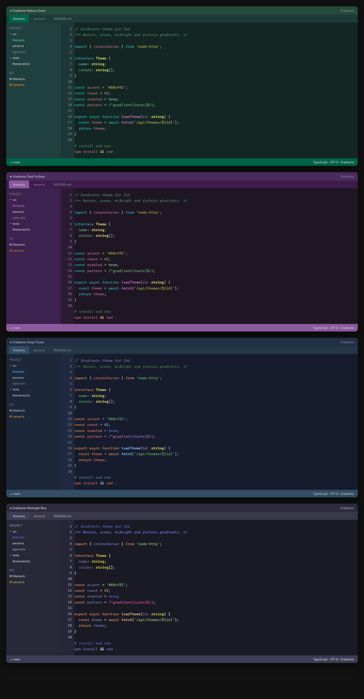

# Gradianto для Zed

Порт темы [Gradianto](https://github.com/thvardhan/Gradianto) (победитель конкурса
тем JetBrains 2019) для редактора [Zed](https://zed.dev). Цвета взяты из
оригинальных JetBrains-схем (`src/*.theme.json` + `src/*.xml`), а не подобраны
на глаз, поэтому палитра совпадает с IntelliJ IDEA и с VS Code-портом.



## Варианты

| Вариант | Фон редактора | Акцент |
|---|---|---|
| **Gradianto Nature Green** | `#132623` | зелёный `#60cf92` |
| **Gradianto Dark Fuchsia** | `#1f1624` | фуксия `#c07cd6` |
| **Gradianto Deep Ocean** | `#161c2d` | синий `#5eb3ff` |
| **Gradianto Midnight Blue** | `#1a1a25` | фиолетовый `#8769cf` |

Все четыре — тёмные. Синтаксис каждой темы строится из её собственной
JetBrains-схемы; у Dark Fuchsia, как и в оригинале, синтаксис совпадает
с Nature Green и меняется только интерфейс.

## Установка (уже выполнена)

Тема лежит в `%APPDATA%\Zed\themes\gradianto.json`, а в `settings.json`
в качестве тёмной темы выбрана Gradianto Nature Green.

Перезапустите Zed, затем выберите тему через палитру команд:

```
theme selector: toggle        (Ctrl+K Ctrl+T)
```

или вручную в `settings.json`:

```jsonc
{
  "theme": {
    "mode": "system",
    "light": "One Light",
    "dark": "Gradianto Nature Green"
  }
}
```

Если нужно поставить тему на другой машине — скопируйте
`themes/gradianto.json` в `%APPDATA%\Zed\themes\` (Windows),
`~/.config/zed/themes/` (Linux) или `~/.config/zed/themes/` (macOS),
либо запустите `install.ps1`.

## Установка как расширения Zed

В папке есть `extension.toml`, поэтому каталог можно подключить как
dev-расширение: палитра команд → `zed: install dev extension` → выбрать
эту папку. Такой вариант удобен, если вы захотите опубликовать порт
в каталоге расширений Zed.

## Как собран порт

`scripts/build.js` парсит JetBrains-схемы и генерирует
`themes/gradianto.json` по схеме Zed `v0.2.0`:

* `CONSOLE_BACKGROUND_KEY` → `editor.background`;
* `GUTTER_BACKGROUND`, `CARET_ROW_COLOR`, `LINE_NUMBERS_COLOR`,
  `INDENT_GUIDE` → соответствующие ключи редактора;
* `ui."*".background`, `EditorTabs`, `ToolWindow`, `MainToolbar`,
  `Tree`, `ScrollBar`, `SearchMatch` → панели, вкладки, статус-бар и скроллбар;
* атрибуты `DEFAULT_*` (ключевые слова, строки, числа, классы, функции,
  поля, параметры, метаданные, операторы, скобки) → `style.syntax`.

Если в `*_new.xml` атрибут не задан, значение берётся из исходного `*.xml`,
а затем из разумного fallback-а (например, тип у Midnight Blue наследуется
от цвета метаданных, как в Darcula).

Пересборка и проверки:

```powershell
node scripts/build.js      # сгенерировать themes/gradianto.json
node scripts/validate.js   # проверить ключи и формат цветов
node scripts/preview.js    # собрать preview.html
```

## Отличия от JetBrains-версии

* В Zed нет градиентных заливок у панелей, поэтому «градиент» передан
  ступенчатыми оттенками: фон приложения → панель → вкладки → редактор.
* Zed использует одну тему на «семью» и не умеет подсвечивать фон
  тулвиндоу отдельно от сайдбара — выбраны наиболее близкие ключи.
* Добавлены ключи, которых нет в JetBrains-схеме (`players`,
  `version_control.*`, `search.active_match_background`), они выведены
  из палитры темы.

## Релизы

Релиз собирается автоматически по тегу. Имя тега должно совпадать с версией
в `extension.toml` (`v0.1.0` ↔ `version = "0.1.0"`):

```powershell
git tag -a v0.1.1 -m "Gradianto 0.1.1"
git push origin v0.1.1
```

Workflow `.github/workflows/release.yml` пересоберёт тему, прогонит проверки,
убедится, что сгенерированные файлы закоммичены, и создаст GitHub Release
с архивом `gradianto-v0.1.1.zip` (его можно распаковать и подключить как
dev-расширение). Повторно опубликовать существующий тег можно вручную:
Actions → Release → Run workflow.

## Лицензия

Код порта, скрипты и сгенерированные темы распространяются по MIT — см.
[`LICENSE`](./LICENSE). Файлы оригинальной JetBrains-темы в `src/`
принадлежат автору Gradianto и включены для воспроизводимой сборки.

## Благодарности

* [thvardhan/Gradianto](https://github.com/thvardhan/Gradianto) — оригинальная
  тема для JetBrains IDE (автор идеи и палитры).
* [Gradianto Nature Green для VS Code](https://github.com/nick-mal/gradianto-nature-green-vscode-theme)
  Николая Малышева (MIT) — использовался как ориентир для маппинга
  синтаксиса и терминала.
